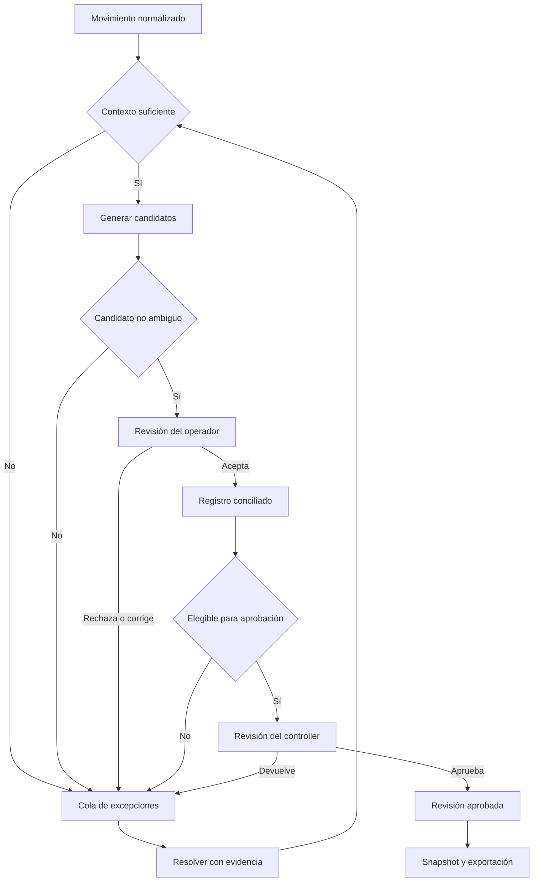
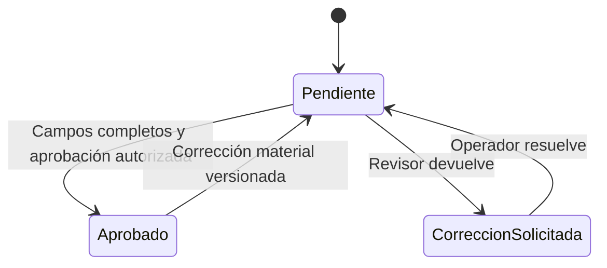
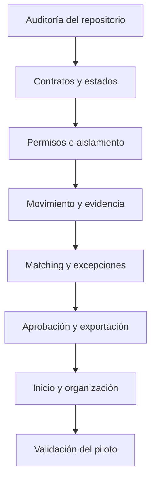

# Web3Rails — Paquete de implementación para Claude Code

> Recibido de Rubén el 9-oct-2026. Es la especificación de producto y los criterios de aceptación del front office.
> El plan de ejecución derivado está en `docs/front-office-plan.md`; la verificación del piloto, en `docs/front-office-verification.md`.

## Cómo usarlo
Guarda este archivo en el repositorio como docs/front-office-implementation.md. Ejecuta primero el prompt maestro. Los prompts de fase sirven para continuar el trabajo por entregas verificables; no hace falta abrir varios agentes ni ejecutarlos en paralelo.
El alcance es una propuesta de producto para los primeros pilotos B2B. No afirma que las capacidades ya existan. El repositorio y sus contratos actuales determinan qué se reutiliza y qué falta construir.

## 1. Prompt maestro
Actúa como ingeniero responsable de implementar el front office de Web3Rails.io. Lee docs/front-office-implementation.md y úsalo como especificación de producto y criterios de aceptación.

OBJETIVO
Entregar una aplicación B2B donde un equipo financiero transforma movimientos de stablecoins en Solana en registros identificados, conciliados, revisados y exportables con evidencia.
El recorrido principal es: conectar o registrar wallets → importar movimientos y facturas → revisar coincidencias → resolver excepciones → aprobar → exportar con evidencia.

ANTES DE EDITAR
1. Lee AGENTS.md y las instrucciones aplicables al repositorio.
2. Identifica el framework, autenticación, base de datos, API, diseño, pruebas y mecanismos de ejecución existentes. Revisa cambios locales y preserva trabajo ajeno.
3. Comprueba si hay landing pública y aplicación de producto separadas. Conserva esa separación y reutiliza el diseño existente.
4. Mapea cada capacidad requerida a implementación existente, capacidad parcial o ausencia. No inventes endpoints ni afirmes que hay servicios funcionando sin comprobarlos.
5. Escribe un plan breve en docs/front-office-plan.md con dependencias y fases. Si faltan APIs, comienza por una funcionalidad completa de extremo a extremo: datos → API → interfaz → acción persistida → evidencia. No te quedes en una maqueta.

AUTONOMÍA
Resuelve decisiones reversibles con el stack existente. Avanza hasta completar el alcance local verificable. Pregunta solo cuando una decisión cambie materialmente coste, arquitectura o producto, o cuando una credencial impida integración real. Si una integración está bloqueada, completa los módulos independientes y explica exactamente el bloqueo.
Usa una rama o checkout aislado si el repositorio lo requiere. No publiques, despliegues, fusiones ni cambies permisos externos sin autorización específica. No hagas cambios destructivos ni sobrescribas datos de producción.

IMPLEMENTACIÓN
Construye las fases de este documento en orden. Prioriza contratos de datos y reglas de conciliación antes de ampliar pantallas. Adapta nombres y rutas a las convenciones del proyecto.
Todo botón visible debe tener comportamiento real, un estado deshabilitado explicado o una indicación explícita de función pendiente. No presentes mocks como producción.
Utiliza componentes existentes; evita añadir dependencias cuando el repositorio ya resuelve la necesidad. No implementes agentes o llamadas a LLM por defecto: las reglas financieras, los estados y las aprobaciones deben ser deterministas. Una sugerencia nunca equivale a una aprobación.

VERIFICACIÓN
Después de cada fase aplica el ciclo de desarrollo de este documento. Prueba las reglas financieras, permisos, aislamiento, idempotencia y cambios concurrentes que puedan causar registros incorrectos. No escribas pruebas que solo repitan el código.
Verifica el flujo con datos de prueba etiquetados, revisa la interfaz en navegador si hay herramientas disponibles y registra comandos, resultados y limitaciones reales.

ENTREGA
Al terminar informa de: qué funciona; rutas principales; migraciones necesarias; configuración pendiente; pruebas ejecutadas y resultados; funciones fuera de alcance. No declares terminado un flujo que solo funcione con mocks.

## 2. Alcance funcional del MVP

### Navegación
| Área | Resultado esperado |
|---|---|
| Inicio | Ver pendientes, discrepancias y estado de sincronización; entrar en la cola correspondiente. |
| Movimientos | Filtrar, buscar y abrir cada registro financiero. |
| Conciliación | Revisar candidatos de factura y confirmar o rechazar coincidencias. |
| Excepciones | Resolver pendientes, registrar decisiones y asignar responsable. |
| Evidencia y exportaciones | Consultar historial y generar un archivo de registros aprobados. |
| Organización | Administrar entidades, wallets y usuarios autorizados. |

El centro de la aplicación es una bandeja de trabajo. Cada fila muestra fecha, entidad, contraparte, token e importe, valoración fiat si existe, factura, estado, motivo de atención y responsable. Debe permitir filtrar pendientes de revisión, sin factura y discrepancias, además de fecha, wallet y entidad.
El detalle contiene cuatro bloques: movimiento blockchain, contexto financiero, propuesta/decisión de conciliación y evidencia/historial. El enlace al explorador debe construirse con una red conocida y un identificador validado.
Diseño: B2B financiero, sobrio, legible, orientado a tablas y decisiones. Reutilizar la marca y componentes del repositorio. Si no hay sistema visual, usar fondo claro, texto oscuro y verde de marca como acento limitado. Mostrar estados con texto además de color. Evitar jerga técnica cuando no ayuda a decidir.

### Fuera del MVP
Iniciación de pagos, custodia, claves privadas, swaps, yield, otras redes, dashboards especulativos, marca propia para partners, conectores ERP múltiples, contabilidad automática irreversible y facturación automática por consumo.
Pagos parciales, agrupados y relaciones muchos-a-muchos quedan como excepciones explícitas si el producto actual no los soporta. No resolverlos con una coincidencia ficticia.

## 3. Contratos mínimos de datos
Adapta estas entidades al esquema existente. No dupliques modelos que ya cumplen la función.

| Entidad | Datos mínimos |
|---|---|
| Organización | ID, nombre, configuración; ámbito de aislamiento. |
| Entidad legal | Organización, nombre, moneda de reporting. |
| Wallet | Organización, entidad, red, dirección pública, etiqueta, propiedad declarada/verificada y su evidencia. |
| Movimiento | Organización, entidad, referencia de origen, red, hash, índice/instrucción cuando proceda, wallets, mint del token, cantidad exacta, decimales, fecha y estado de origen. |
| Contexto financiero | Movimiento, contraparte, propósito, categoría, referencia y revisión actual. |
| Valoración | Movimiento, importe fiat, moneda, fuente, timestamp de valoración, método y versión. |
| Factura | Organización, entidad, contraparte, referencia, moneda, importe, fecha, documento y origen de importación. |
| Propuesta de match | Movimiento, factura candidata, señales, diferencias, versión de regla y estado. |
| Decisión de match | Propuesta o vínculo manual, actor, fecha, motivo y versión del registro. |
| Excepción | Registro afectado, tipo, estado, responsable, comentarios y resolución. |
| Evento de auditoría | Organización, registro, acción, actor autenticado, timestamp del servidor, antes/después o referencias versionadas, motivo. |
| Exportación | Organización, actor, filtros, versión/esquema, registros y revisiones incluidas, fecha, estado y referencia al archivo. |

No asumas que un hash identifica un único movimiento: una transacción puede contener varios. Define una clave estable según el proveedor y el nivel de normalización. Cantidades monetarias: enteros en unidad mínima o decimal exacto; nunca float binario para cálculos contables. Identifica tokens por red y mint, no por símbolo solamente.

## 4. Reglas e invariantes
1. Organización y permisos se validan en servidor. Ocultar botones no constituye control de acceso. Un usuario no puede consultar documentos, movimientos ni exportaciones de otra organización alterando un ID.
2. La ingestión debe ser idempotente con una clave documentada. Reimportar la misma fuente no crea duplicados. Una diferencia de cantidad o contenido no se descarta silenciosamente: se registra y revisa.
3. Mantén datos originales de origen separados de las interpretaciones financieras. Las correcciones financieras generan revisiones; no reescriben el origen.
4. Dirección de wallet no equivale por sí sola a identidad jurídica. Una transferencia entre wallets conocidas de la misma entidad debe poder clasificarse como transferencia interna; evita contar dos veces el mismo hecho económico.
5. Token o stablecoin no equivale automáticamente a una moneda fiat ni a una paridad exacta. Sin fuente de valoración, mostrar “sin valoración”, no cero.
6. Solo proponer matching compatible con organización, entidad y moneda/token según una conversión explícita. La tolerancia debe ser configurable, documentada y mostrada; no inventes un porcentaje por defecto. Caso ambiguo: requiere revisión.
7. Matching inicial 1:1. Una factura ya vinculada no puede consumirse de nuevo salvo política explícita que soporte parcialidades; una factura pendiente puede tener varios candidatos sin varios vínculos aceptados.
8. Explica señales: referencia exacta, contraparte conocida, importe compatible y ventana temporal. No muestres porcentajes de confianza sin calibración. Señales insuficientes generan una excepción.
9. Una propuesta de match requiere decisión explícita del usuario autorizado. Registrar coincidencia, clasificación y aprobación como acciones distintas.
10. Aprobar exige campos obligatorios completos y ausencia de excepciones bloqueantes. El servidor decide elegibilidad; el frontend muestra el motivo del bloqueo.
11. Una corrección material después de aprobar —factura, entidad, categoría, importe o valoración— invalida la aprobación y requiere revisión nueva. Conserva el historial y las exportaciones anteriores.
12. Controla concurrencia con versiones o mecanismo equivalente. Dos usuarios no deben sobrescribir decisiones ni vincular la misma factura por carrera. Devuelve conflicto comprensible y permite recargar.
13. Exportar crea un snapshot consistente de revisiones aprobadas. Una exportación anterior sigue consultable y conserva sus referencias aunque el registro cambie después.
14. Auditoría producida en servidor con actor autenticado. Para la aplicación es append-only; no anuncies inmutabilidad criptográfica o certificación sin una implementación que lo demuestre.
15. Los KPIs financieros incluyen solo valores compatibles y muestran moneda, cobertura y fecha. No sumar tokens distintos ni mezclar valoraciones sin indicar el criterio.
16. Integración real y modo demo deben estar separados. Datos demo claramente identificados y sin acceso a recursos de producción. Nunca simular “wallet conectada”, “aprobado” o “exportado” ante un fallo real.

### Permisos iniciales
| Rol | Acciones |
|---|---|
| Administrador | Organización, wallets y accesos; las acciones financieras requieren permisos explícitos. |
| Operador | Identificar, clasificar, proponer/decidir matching y resolver excepciones autorizadas. |
| Revisor/controller | Revisar, aprobar y devolver correcciones. |
| Auditor | Leer registros, revisiones, documentos y evidencia autorizados. |

Configura si se permite autoaprobación. En el modo de revisión por otra persona, el autor de la decisión material no puede aprobarla. Usa la política existente del proyecto si ya está definida.

## 5. Graphs de producto

### Flujo de decisión

Los estados de origen blockchain, identificación, conciliación, revisión y exportación son dimensiones separadas. “Conciliado” no significa “aprobado”. “Exportado” es un historial de snapshots, no un bloqueo permanente del movimiento.

### Corrección posterior

Cada transición debe tener precondición, permiso, mutación transaccional y evento de auditoría. La exportación referencia una revisión aprobada concreta.

### Dependencias de construcción

## 6. Loops operativos

### Loop A — sincronización
Leer desde checkpoint → validar origen → normalizar → upsert idempotente → registrar errores por registro → actualizar checkpoint solo hasta el tramo procesado correctamente → informar última sincronización y datos pendientes.
Usa límites, timeouts y reintentos acotados para fallos transitorios; después del límite, marca fallo visible. No implementes polling intensivo ni un loop infinito. Reutiliza el mecanismo de jobs del proyecto. Una paginación incompleta no debe mostrarse como sincronización completa.

### Loop B — resolver excepciones
Seleccionar un pendiente → leer su revisión actual → entender el motivo → aportar contexto/documento → previsualizar decisión → guardar con control de versión → recalcular elegibilidad → conservar evidencia → pasar al siguiente pendiente.
Si falta información externa, permitir “en espera” con responsable y motivo. Evitar que el mismo registro vuelva a la cola como si nunca se hubiera revisado. Las reglas aprendidas solo se guardan si el usuario las confirma y su alcance queda explícito.

### Loop C — cierre financiero
Definir periodo y entidad → ver cobertura y pendientes → resolver bloqueantes → aprobar revisiones → generar snapshot de exportación → verificar archivo → registrar resultado.
El MVP ofrece una vista de cierre; no promete cierre contable legal definitivo ni integración ERP completa. La revisión anterior permanece consultable cuando una corrección genera una nueva.

### Loop D — desarrollo en Claude Code
Para cada fase:
1. Leer estado y dependencias reales.
2. Definir un resultado observable y sus criterios de aceptación.
3. Implementar el cambio mínimo que completa ese resultado.
4. Ejecutar las comprobaciones pertinentes.
5. Revisar el flujo desde la interfaz y verificar persistencia.
6. Corregir causas de fallos, sin ocultarlos ni relajar los criterios.
7. Registrar evidencia y continuar a la fase siguiente.
Si el mismo bloqueo persiste tras dos intentos razonados, diagnostica la causa, cambia de estrategia o registra la dependencia externa. No repitas el mismo comando indefinidamente. No abandones el resto del trabajo independiente.

## 7. Prompts secuenciales

### Fase 0 — auditar y planificar
Aplica el prompt maestro. Inspecciona el repositorio y crea docs/front-office-plan.md con estado actual, funcionalidades reutilizables, dependencias ausentes, riesgos concretos y orden de implementación. Identifica las instrucciones de ejecución y pruebas. Explica si el alcance requiere backend adicional. No instales otro stack ni reconstruyas la landing. Tras el diagnóstico, continúa con la primera fase viable.

### Fase 1 — contratos, permisos y primera funcionalidad completa
Implementa los contratos mínimos, estados separados, precisión monetaria, aislamiento por organización, permisos y auditoría del paquete. Reutiliza auth y persistencia existentes. Incluye migraciones compatibles y un mecanismo de versiones para conflictos. Construye una funcionalidad completa: listar un movimiento, abrir su detalle, editar contexto autorizado, persistir la revisión y mostrar el evento de auditoría. Si falta ingestión real, utiliza importación explícita con validación; el modo demo debe quedar separado.
Verifica acceso entre organizaciones, rol auditor, edición concurrente, revisión y precisión monetaria. Entrega un flujo que funciona después de recargar.

### Fase 2 — bandeja y detalle financiero
Construye la bandeja de movimientos y su detalle según el paquete. Añade filtros, búsqueda, ordenación y paginación en servidor si el volumen lo requiere. Conserva filtros al abrir y volver del detalle. Implementa carga, vacío, error, datos desactualizados y permisos insuficientes. Incluye contraparte, entidad, factura, valoración y evidencia, distinguiendo desconocido de cero.
La acción principal de cada pendiente debe llevar a su resolución. Verifica navegación por teclado, legibilidad, comportamiento responsive y precisión de los importes. No añadas gráficos sin una decisión financiera que los justifique.

### Fase 3 — matching y excepciones
Implementa importación de facturas con previsualización y errores por fila. Construye matching determinista 1:1 con señales explicables, rechazo de ambigüedad, prevención de doble vinculación y tolerancia explícita. El usuario acepta o corrige; ningún candidato se aprueba automáticamente.
Crea la cola de excepciones con motivo, responsable, comentarios y resolución con evidencia. Una decisión que cambia el registro genera revisión e historial. Verifica coincidencia válida, candidatos ambiguos, moneda incompatible, duplicado de importación, factura ya consumida y carrera entre dos operadores. Los pagos parciales/agrupados no soportados deben quedar pendientes con razón clara.

### Fase 4 — aprobación, evidencia y exportación
Implementa precondiciones de aprobación, política de autoaprobación y rol de revisor. Los cambios materiales invalidan la aprobación sin borrar el historial. Crea exportación CSV de revisiones aprobadas con esquema documentado, exactitud de importes, snapshot y referencias a evidencia autorizada. No generes enlaces públicos a documentos privados. Neutraliza fórmulas de hoja de cálculo en campos textuales exportados sin modificar sus valores monetarios.
Verifica permisos, registros bloqueados, exportación durante una edición concurrente y corrección posterior a una exportación. Confirma que el archivo descargado corresponde al snapshot registrado y que una exportación anterior sigue disponible según las políticas de conservación existentes.

### Fase 5 — inicio, organización y piloto
Conecta los indicadores de inicio a datos reales y filtros de la bandeja. Implementa administración básica de entidades, wallets públicas y usuarios según capacidades existentes. Muestra última sincronización, cobertura de valoración y errores reales. No solicites claves privadas.
Revisa consistencia visual y términos financieros. Ejecuta el recorrido completo del paquete con datos de prueba etiquetados. Actualiza la documentación de uso, configuración y limitaciones. Solo declara MVP operativo si los datos y acciones persisten y las verificaciones financieras y de permisos pasan.

### Prompt de reparación — usar tras detectar un fallo
Reproduce el fallo descrito y determina si nace en datos, contrato API, permisos, estado, concurrencia o UI. Corrige la causa con el cambio mínimo coherente con docs/front-office-implementation.md. No sustituyas datos reales por mocks, no suprimas errores y no relajes permisos ni criterios de aprobación para hacer pasar el flujo. Añade una prueba de regresión solo cuando proteja una regla sustancial. Verifica el escenario original y las rutas directamente afectadas; documenta el resultado.

## 8. Escenario de aceptación del piloto
Crear una organización de prueba con dos entidades, varias wallets públicas declaradas, operadores y revisor. Crear una segunda organización para comprobar aislamiento. Cargar un conjunto pequeño de movimientos y facturas etiquetados con: coincidencia exacta, contraparte desconocida, referencia duplicada, diferencia de importe, token distinto con símbolo similar, transferencia interna, valoración ausente y pago parcial no soportado.
Comprobar:
- Reimportar no duplica movimientos ni facturas.
- Una coincidencia válida se acepta y conserva explicación.
- Un candidato ambiguo no se convierte automáticamente en vínculo.
- Una factura no puede vincularse dos veces por una carrera.
- Una excepción se resuelve con motivo y actor.
- Un registro incompleto no se aprueba.
- Una corrección material invalida aprobación y conserva revisiones anteriores.
- El auditor no puede mutar; otra organización no puede acceder por ID.
- La exportación contiene las revisiones aprobadas correctas y sus importes exactos.
- Recargar conserva decisiones; el historial explica el recorrido completo.
Registrar estos resultados en docs/front-office-verification.md con pruebas ejecutadas, resultado observado y bloqueos. Esta es la puerta para un piloto; no sustituye evaluación de seguridad o validación contable del controller.

## 9. Métricas de producto para validar, no para decorar
Medir tiempo hasta resolver una excepción, porcentaje de movimientos conciliados, porcentaje aceptado sin corrección por el revisor, minutos de trabajo por periodo y tiempo hasta la primera exportación útil. Definir denominador y periodo de cada métrica; separar reglas propuestas de decisiones aceptadas.
La cifra estratégica del 1 % de Swift no debe aparecer como KPI operativo ni como capacidad conseguida. Las tarifas US$0,01–1 por evento son hipótesis comerciales y no requieren construir billing en este MVP.
